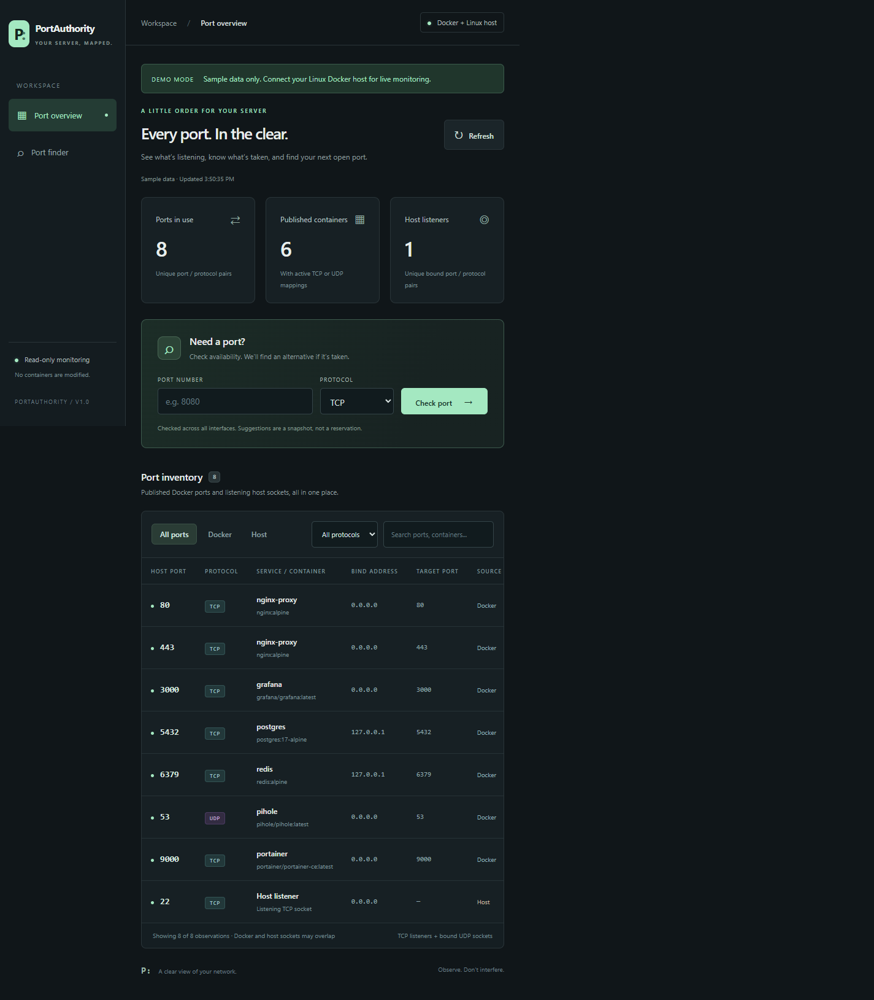
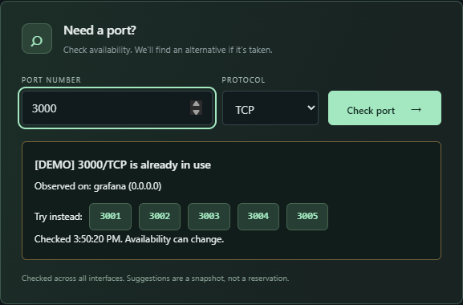

# PortAuthority

PortAuthority gives you one place to look when you need to know which ports your server is using. It brings together published Docker ports and Linux host TCP/UDP sockets, so you can check what is already bound before adding another service.

It is a small, read-only dashboard, not a container manager. It never starts, stops, or modifies containers. There are no npm dependencies to install, no frontend build step, no external fonts, and no telemetry.

## A look around

The overview shows the port, protocol, bind address, and source of each observation. For Docker mappings, it also shows the container name, image, and target port. You can narrow the list to Docker or host sockets, filter by protocol, or search for a port or container.



*Both screenshots in this README use the built-in demo data, not a live server.*

The port finder is useful when a service's usual port is already taken. Here, checking `3000/TCP` finds the demo Grafana container and offers five alternatives. Clicking an alternative checks that port again; it does not reserve it or change your deployment.



## Try it locally first

If you just want to see how the dashboard works, you only need Node.js 22 or newer. From the project directory, run:

```sh
npm run demo
```

Open http://localhost:8787. The demo banner makes it clear that you are looking at sample data: this mode does not inspect your machine or need access to Docker. Stop the server with Ctrl+C when you are done.

Demo mode also works for a preview on Windows or macOS. For real host visibility, deploy to a Linux Docker Engine server using the steps below. Docker Desktop runs containers inside a VM, so its network view is not the same as the Windows or macOS host.

## Run on your Linux Docker server

You will need Docker Engine and Docker Compose on the server. Run these commands from the project directory on that machine:

```sh
export DOCKER_GID=$(stat -c '%g' /var/run/docker.sock)
docker compose up -d --build
```

The first command gives the container the group access it needs for the Docker socket. Compose then builds and starts the dashboard in the background.

The deployment uses host networking on purpose. This lets PortAuthority read the **host network namespace's** `/proc/net` socket tables, including sockets used by host-networked containers, rather than only seeing its own isolated container network.

By default, the dashboard listens on **127.0.0.1:8787 on the Docker server**. If your browser is on another machine, open an SSH tunnel from that machine:

```sh
ssh -L 8787:127.0.0.1:8787 your-user@your-docker-server
```

Leave the SSH session open, then visit http://localhost:8787 in your browser. The tunnel forwards your local connection to the dashboard without opening it to the network.

If the server is already using port 8787, change `PORT` in [compose.yaml](compose.yaml) and update the remote port in the tunnel command to match. With host networking, you change the application's port directly; there is no Compose port mapping to adjust.

### Keep the dashboard private

There is **no built-in authentication**. Keep the loopback bind and use an SSH tunnel for personal access. If you need to share the dashboard, put it behind an authenticated HTTPS reverse proxy. Do not expose it directly to the internet.

The Docker socket deserves particular care. PortAuthority only makes read requests, but mounting the socket read-only does **not** make the Docker API read-only. The socket still provides powerful access to the Docker daemon. Deploy only on a trusted host; for a hardened deployment, use a restricted socket proxy that allows only `GET /containers/json`.

### Run without a container

You can also run PortAuthority directly on Linux with Node.js 22 or newer:

```sh
npm start
```

Run it as a user with access to the Docker socket and the host's Linux socket tables. No package installation is needed. Native Windows and macOS do not provide those Linux tables; live mode reports the missing sources rather than treating them as empty.

## Using the dashboard

The inventory refreshes every 15 seconds while the page is visible. Use **Refresh** when you want a fresh snapshot straight away. The source tabs, protocol filter, and search field work together, so you can, for example, show only Docker TCP mappings and then search for a container name.

The counts at the top and the rows in the table answer slightly different questions:

- **Ports in use** counts distinct port/protocol pairs. TCP and UDP on the same number count separately.
- **Published containers** counts running containers with at least one published TCP or UDP mapping, not every running container.
- **Host listeners** counts distinct host port/protocol pairs.
- **The inventory** keeps individual observations, including different bind addresses. A Docker mapping and a host socket can describe the same port, so seeing both is expected.

To check a port, enter a number from 1 to 65535, choose TCP or UDP, and select **Check port**. If it is occupied and all sources are available, the finder offers up to five unused non-privileged alternatives for that protocol.

Pay attention to source warnings and update times. If Docker or a host socket table cannot be read, the dashboard calls out the missing source. It can still show a known conflict, but it will not claim that a port is available or suggest alternatives without complete visibility. If a refresh fails, the previous inventory stays visible and is marked stale.

## Configuration

These settings are environment variables read by the server. For a Compose deployment, set them in the service's `environment` section in [compose.yaml](compose.yaml) and recreate the container. `DOCKER_GID` is a separate Compose setting used to grant socket group access; it is not an application setting.

| Environment variable | Default | Description |
|---|---|---|
| `HOST` | `127.0.0.1` | Dashboard bind address; keep this private |
| `PORT` | `8787` | Dashboard HTTP port |
| `DOCKER_SOCKET` | `/var/run/docker.sock` | Local Docker Unix socket path |
| `PROC_NET_PATH` | `/proc/net` | Directory containing the network namespace's socket tables |
| `DEMO` | `false` | Set exactly `true` to use sample data instead of inspecting the host |

If you change a socket or table path inside the container, make sure the corresponding host resource is accessible at that path too. Changing the variable alone does not add a mount.

## What an availability result means

An "available" result means PortAuthority did not find a published Docker mapping or bound host socket for that port and protocol in the current snapshot. It is an observation, **not a reservation**. Another process can take the port before your service starts.

Checks are deliberately conservative across **all interfaces**. A port bound only on loopback is treated as taken even if binding another address might work. TCP and UDP are checked separately. Suggestions search above the requested port within the 1024-65535 range, wrapping back to 1024 at the upper end and skipping occupied ports.

There are a few limits worth knowing before relying on a result:

- TCP data includes listening sockets, not established connections or `TIME_WAIT`. UDP data includes bound sockets, including connected UDP sockets. Both IPv4 and IPv6 tables are read.
- Host process names are not collected. Host-networked containers appear as host listeners, not as attributed Docker mappings.
- The checks do not account for OS reserved ranges, firewall rules, transient sockets, privileged-port permissions, Swarm ingress reservations, or other network namespaces.
- Stopped-container configurations are not active reservations and do not appear as published ports.

In short, use the dashboard to find likely conflicts and choose a candidate, then confirm that your service actually binds successfully. An unused port is not a promise that a service will be reachable through the firewall.

## Read-only API

The dashboard uses two GET endpoints, which you can also query from a script:

```sh
curl http://127.0.0.1:8787/api/ports
curl 'http://127.0.0.1:8787/api/check?port=8080&protocol=tcp'
```

`/api/ports` returns the inventory, source errors, completeness flag, demo flag, and snapshot time. `/api/check` returns the requested port and protocol, observed owners, availability, and alternatives, along with source and snapshot information. Its `available` value is `true` when no conflict was found with complete visibility, `false` when a conflict was found, and `null` when availability cannot be confirmed.

These endpoints have the same lack of authentication as the dashboard. Keep API access private too.

## Troubleshooting

**Docker data is missing.** Check that Docker is running, that the socket path is correct, and that the server user can access it. With Compose, make sure `DOCKER_GID` matches the group that owns the host socket and recreate the container after changing it.

**Host tables are unavailable.** Live monitoring needs Linux socket tables. In the supplied Compose deployment, keep `network_mode: host` so the app observes the server's network namespace. On native Windows or macOS, use demo mode for a preview.

**The dashboard will not start because the address is in use.** Pick another `PORT` and adjust your browser URL or SSH tunnel accordingly. Bind addresses matter: a port used on one interface can still prevent a wildcard bind on that port.

**The page opens on the server but not from your laptop.** The default bind is loopback-only, so direct remote access is intentionally unavailable. Use the SSH tunnel above rather than making the dashboard public.

## Development

The server and browser code run without a build step or dependency installation. To run the test suite:

```sh
npm test
```

### CI and releases

The [CI workflow](.github/workflows/ci.yml) runs on branch pushes and pull requests. It tests the app on Node.js 22 and 24 and builds the Docker image without publishing it. There is no dependency installation step because the app uses Node's built-in modules.

The separate [release workflow](.github/workflows/release.yml) runs when you push a `v`-prefixed semantic version tag. For a stable release:

```sh
git tag v1.2.3
git push origin v1.2.3
```

For a release candidate, use a tag such as `v1.3.0-rc.1`. The workflow validates the full SemVer format and reruns the tests on both Node versions before publishing anything. Tags such as `v1.2` or `v01.2.3` fail validation; tags without the `v` prefix do not trigger a release.

Once the tests pass, it publishes a Linux amd64 image to `ghcr.io/<owner>/<repository>:<version>` and creates a GitHub Release with generated notes and the image digest. For this repository, `v1.2.3` produces `ghcr.io/stupiddevmonkey/portauthority:1.2.3`. Prerelease tags create GitHub prereleases and keep their full version in the image tag, such as `1.3.0-rc.1`.

Only version-specific image tags are published; there is no moving `latest` tag. SemVer build metadata is supported, with `+` replaced by `_` in the Docker tag: `v1.2.3+build.7` becomes `1.2.3_build.7`. The original Git tag and GitHub Release name stay unchanged. Versions must fit Docker's 128-character tag limit.

Publishing uses the repository's automatic `GITHUB_TOKEN` with release and package write permissions, so no registry password needs to be added. Repository or organization policies must allow those permissions. If a GHCR package with the same name already exists, grant this repository Actions access to it. Check the package's visibility in GitHub if you want people to pull it without signing in.

Push a new tag for each release rather than moving an existing one. The tag is the release version; the workflow does not rewrite `package.json`.
